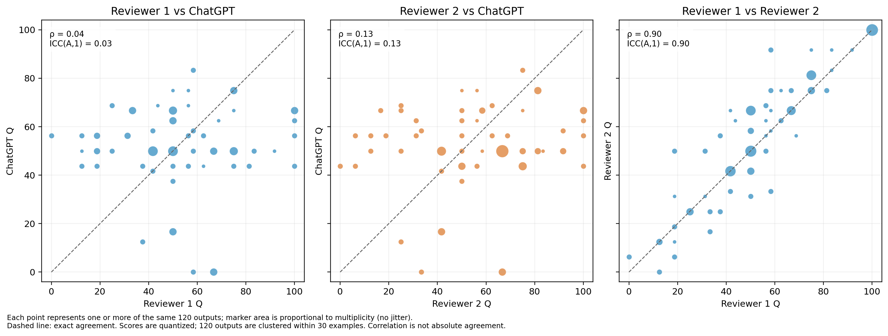
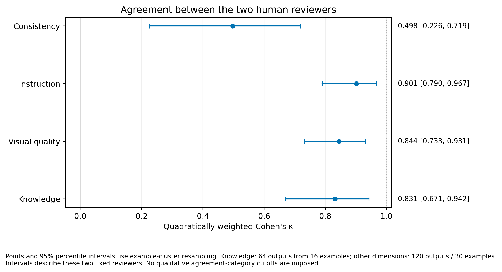
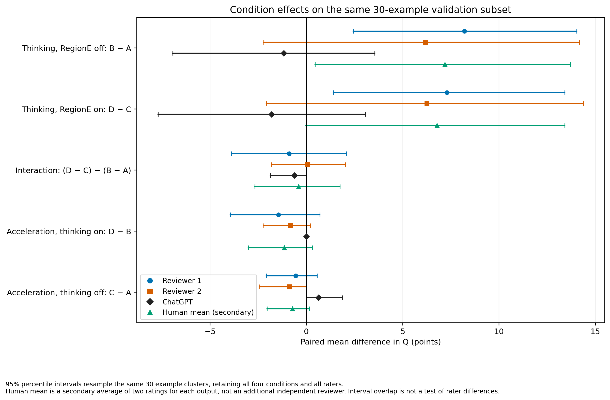

# RQ3 supplementary human–judge validation

This analysis compares two human reviewers with the recorded ChatGPT judge on 120 identical outputs from 30 examples (10 factual, 10 conceptual and 10 procedural), with conditions A–D for every example. The four practice ratings from each reviewer are excluded. The subset was selected after generation and the original analysis; this is supplementary validation, not a preregistered independent replication.

Q is the mean of 25 × (score − 1) over the applicable ordinal scoring dimensions. Knowledge is applicable to 64 outputs from 16 examples. All other dimensions apply to all 120 outputs. Human mean denotes the per-output average of the two human Q values and is a secondary summary.

## Agreement and score differences

Relative to Reviewer 1, ChatGPT's mean Q difference was -2.22 [-11.84, 6.96] points and its mean absolute difference was 23.40 [18.37, 28.84] points; relative to Reviewer 2, ChatGPT's mean Q difference was -4.55 [-13.92, 4.72] points and its mean absolute difference was 24.69 [20.30, 29.48] points. These are paired comparisons of identical outputs; bracketed values are 95% confidence intervals.

| Human–human dimension | Outputs / examples | Quadratic κ [95% CI] |
| --- | --- | --- |
| Consistency | 120 / 30 | 0.498 [0.226, 0.719] |
| Instruction | 120 / 30 | 0.901 [0.790, 0.967] |
| Visual quality | 120 / 30 | 0.844 [0.733, 0.931] |
| Knowledge | 64 / 16 | 0.831 [0.671, 0.942] |

| First / second rater | Spearman ρ [95% CI] | ICC(A,1) [95% CI] | Mean second − first Q [95% CI] | Mean absolute Q difference [95% CI] |
| --- | --- | --- | --- | --- |
| Reviewer 1 / Reviewer 2 | 0.898 [0.813, 0.951] | 0.899 [0.819, 0.943] | 2.33 [-0.87, 5.36] | 7.43 [5.26, 9.69] |
| Reviewer 1 / ChatGPT | 0.042 [-0.245, 0.318] | 0.027 [-0.186, 0.211] | -2.22 [-11.84, 6.96] | 23.40 [18.37, 28.84] |
| Reviewer 2 / ChatGPT | 0.133 [-0.157, 0.397] | 0.134 [-0.074, 0.308] | -4.55 [-13.92, 4.72] | 24.69 [20.30, 29.48] |

Spearman's ρ measures association in ranking, whereas ICC(A,1) measures absolute agreement under a two-way mixed-effects, single-measurement model for each named fixed rater pair. A positive signed difference means that the second rater assigned higher Q. Correlation alone does not establish agreement, and agreement between two reviewers does not establish objective correctness.

Figure 1. Q agreement for each human–judge pair and the human–human pair. Exact overlaps are shown by proportional marker area; no jitter changes the recorded values. [PDF](figures/agreement_q.pdf).

Figure 2. Quadratically weighted human–human agreement by scoring dimension, with confidence intervals obtained by resampling examples. [PDF](figures/human_human_kappa.pdf).

## Condition effects on the validation subset

A uses neither thinking nor RegionE; B enables thinking; C enables RegionE; D enables both. All comparisons below use the same 30 examples and the existing generations. These estimates should be compared across raters within this subset rather than directly equated with the original 40-example results.

| Rater | A: mean Q [95% CI] | B: mean Q [95% CI] | C: mean Q [95% CI] | D: mean Q [95% CI] |
| --- | --- | --- | --- | --- |
| Reviewer 1 | 49.38 [40.97, 57.99] | 57.57 [49.51, 65.97] | 48.82 [40.28, 57.71] | 56.11 [48.33, 64.10] |
| Reviewer 2 | 52.64 [43.61, 61.67] | 58.82 [49.24, 68.19] | 51.74 [42.92, 60.63] | 57.99 [48.47, 67.36] |
| ChatGPT | 51.18 [45.76, 55.76] | 50.00 [42.43, 56.81] | 51.81 [46.32, 56.46] | 50.00 [42.43, 56.81] |
| Human mean (secondary) | 51.01 [42.43, 59.79] | 58.19 [49.69, 66.77] | 50.28 [41.77, 59.03] | 57.05 [48.72, 65.49] |

| Contrast | Reviewer 1 [95% CI] | Reviewer 2 [95% CI] | ChatGPT [95% CI] | Human mean (secondary) [95% CI] |
| --- | --- | --- | --- | --- |
| Thinking, RegionE off: B − A | 8.19 [2.43, 14.03] | 6.18 [-2.22, 14.17] | -1.18 [-6.94, 3.54] | 7.19 [0.45, 13.72] |
| Thinking, RegionE on: D − C | 7.29 [1.39, 13.40] | 6.25 [-2.09, 14.38] | -1.81 [-7.71, 3.06] | 6.77 [-0.03, 13.40] |
| Interaction: (D − C) − (B − A) | -0.90 [-3.89, 2.08] | 0.07 [-1.81, 2.01] | -0.62 [-1.88, 0.00] | -0.42 [-2.67, 1.74] |
| Acceleration, thinking on: D − B | -1.46 [-3.96, 0.69] | -0.83 [-2.22, 0.21] | 0.00 [0.00, 0.00] | -1.15 [-3.02, 0.31] |
| Acceleration, thinking off: C − A | -0.56 [-2.08, 0.56] | -0.90 [-2.43, 0.00] | 0.62 [0.00, 1.88] | -0.73 [-2.05, 0.14] |

Figure 3. Paired condition effects under each rater and the secondary human mean. All estimates use the same examples, with paired cluster confidence intervals. [PDF](figures/condition_effects.pdf).

B − A and D − C estimate the thinking effects without and with RegionE. Their difference estimates the thinking × acceleration interaction; D − B and C − A estimate acceleration effects at fixed thinking settings. An interval containing zero does not prove equivalence. Preserving a positive thinking benefit requires first establishing that benefit under the relevant scoring scheme; an unchanged or small interaction is insufficient.

The accompanying effect-difference table directly estimates each human-scored contrast minus the ChatGPT-scored contrast on these same examples. These comparisons are exploratory; overlapping individual confidence intervals are not a formal test of the difference between raters.

## Disagreement inspection

The following outputs have the largest absolute difference between ChatGPT Q and the secondary human mean. Selection is post hoc and intended for error inspection, not for estimating the prevalence of a failure type. A discrepancy identifies a case for examination, not which rater is correct.

| Example | Condition | Reviewer 1 Q | Reviewer 2 Q | ChatGPT Q | ChatGPT − human mean |
| --- | --- | --- | --- | --- | --- |
| count_change__16 | A | 66.67 | 66.67 | 0.00 | -66.67 |
| count_change__16 | B | 66.67 | 66.67 | 0.00 | -66.67 |
| count_change__16 | C | 66.67 | 66.67 | 0.00 | -66.67 |
| count_change__16 | D | 66.67 | 66.67 | 0.00 | -66.67 |
| medicine__24 | B | 100.00 | 100.00 | 43.75 | -56.25 |
| medicine__24 | D | 100.00 | 100.00 | 43.75 | -56.25 |
| rule-based_reasoning__43 | A | 0.00 | 6.25 | 56.25 | 53.12 |
| rule-based_reasoning__43 | C | 0.00 | 6.25 | 56.25 | 53.12 |
| count_change__48 | B | 58.33 | 33.33 | 0.00 | -45.83 |
| count_change__48 | D | 58.33 | 33.33 | 0.00 | -45.83 |

[count_change__16 / A: Reviewer 1 case page](../reviewer_1/cases/review_d30678f51fbc90cd.html)

[count_change__16 / A: Reviewer 2 case page](../reviewer_2/cases/review_bdb4fde808ba6cc4.html)

[count_change__16 / B: Reviewer 1 case page](../reviewer_1/cases/review_7fc7b73b647a5abf.html)

[count_change__16 / B: Reviewer 2 case page](../reviewer_2/cases/review_1ff8e6240fa336cb.html)

[count_change__16 / C: Reviewer 1 case page](../reviewer_1/cases/review_a6668a260326d066.html)

[count_change__16 / C: Reviewer 2 case page](../reviewer_2/cases/review_292e91c57cb6e992.html)

## Uncertainty, provenance and limits

Confidence intervals are 95% percentile intervals from 10,000 bootstrap replicates (seed 42), resampling the 30 examples as clusters while preserving their four conditions and rater pairings. The 120 outputs are not 120 independent examples. Undefined bootstrap statistics are excluded from their corresponding percentile calculation; valid and invalid replicate counts are recorded in agreement.csv. Undefined point estimates or intervals are reported explicitly rather than replaced with zero.

The agreement measures and example-cluster resampling follow the existing validation guide. Their executable implementation was completed after the human submissions were available; it was not preregistered or implemented without access to outcomes. This timing must be distinguished from the earlier specification of the high-level validation methods.

The two named humans are fixed reviewers. Their results do not establish agreement for a population of human raters, all 40 original examples, additional generation seeds, or conditions E/F. Human validation of A–D does not directly validate the RIKV/AVD component ablations. The human mean does not double the number of independent examples. Prior exposure and independence disclosures remain part of the reviewer metadata.

Original submitted CSV and metadata files are preserved. Two encoding-damaged optional notes in Reviewer 2's submission are represented safely in derived artifacts; the raw submission is unchanged. This analysis does not alter human ratings, original ChatGPT judgments, the frozen quality margin, or generation records, and it requires no new model inference. Read the machine-readable checks and provenance alongside these summaries.

## Machine-readable results

[Report, checks and provenance](report.json)

[Agreement statistics and bootstrap validity counts](tables/agreement.csv)

[Condition means](tables/condition_means.csv)

[Paired condition effects](tables/paired_effects.csv)

[Exploratory effect differences from ChatGPT](tables/effect_differences_vs_judge.csv)

[Joined output-level scores](tables/joined_scores.csv)

[Ranked output-level disagreements](tables/disagreements.csv)
